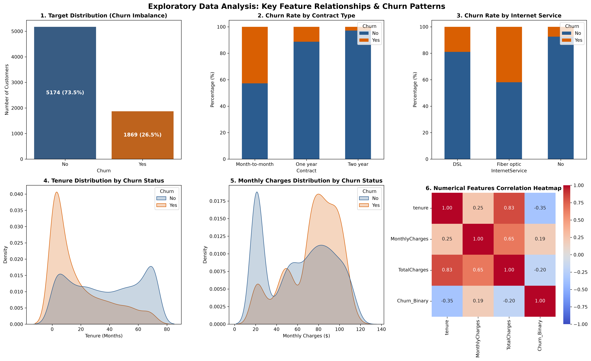
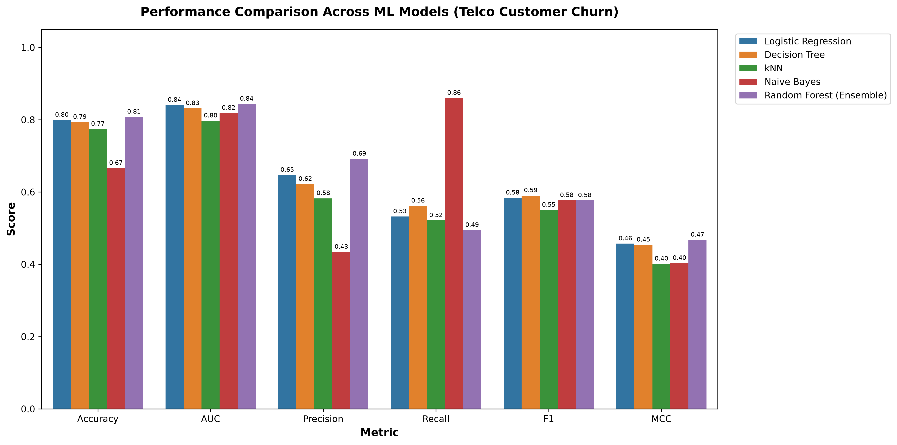
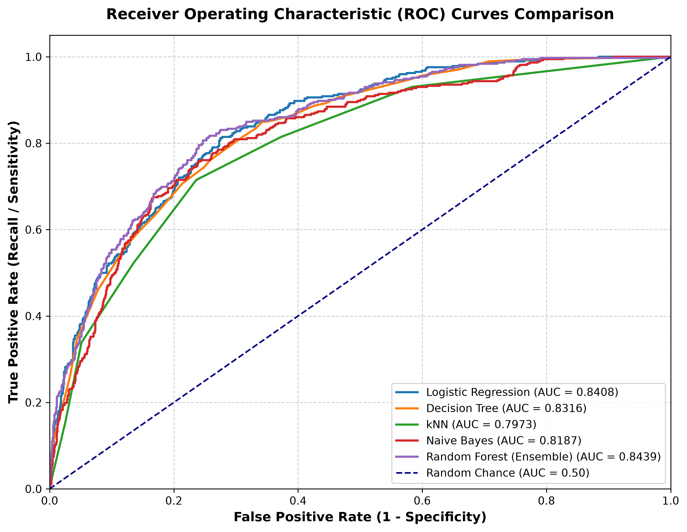

# BITS Pilani - M.Tech (AIML) Machine Learning Assignment 2
## Telco Customer Churn Classification Analysis

---

**Student Name:** Vignesh K  
**BITS ID:** 2026CT05053  
**Course:** Machine Learning  
**Submission Date:** November 2026 

---

## 1. Problem Statement

Customer churn is one of the most critical challenges facing the telecommunications industry. Acquiring a new customer is estimated to be 5 to 25 times more expensive than retaining an existing customer. When a subscriber terminates their service or switches to a competitor, the service provider loses recurring subscription revenues, cross-selling opportunities, and past customer acquisition investments.

The primary objective of this project is to build and benchmark **five supervised machine learning classification models** to predict whether a telecom customer is likely to churn (`Churn = 'Yes'`) or remain subscribed (`Churn = 'No'`). By accurately identifying customers at high risk of attrition, telecom business leaders and marketing retention teams can:
1. Target proactive, tailored retention interventions (e.g., customized contract discounts, loyalty perks, technical support outreach).
2. Prioritize high-value accounts that show indicators of dissatisfaction or high monthly billing stress.
3. Optimize operational retention expenditures by focusing customer success resources on genuine at-risk subscribers.

---

## 2. Dataset Description

The dataset utilized for this study is the widely recognized **Telco Customer Churn** dataset provided by IBM via Kaggle.

- **Dataset Source URL:** [Telco Customer Churn on Kaggle (IBM)](https://www.kaggle.com/datasets/blastchar/telco-customer-churn)
- **Local File Path:** `Dataset/WA_Fn-UseC_-Telco-Customer-Churn.csv`
- **Total Raw Instances:** 7,043 customer records
- **Total Cleaned Instances (after removing feature duplicates):** 7,021 unique customer profiles
- **Total Features:** 20 feature attributes + 1 non-predictive customer ID (`customerID`) = 21 columns
- **Target Variable:** `Churn` (Binary: `"Yes"` = 1, `"No"` = 0)
- **Class Distribution:**
  - `No` (Retained customers): **5,163 instances (73.52%)**
  - `Yes` (Churned customers): **1,858 instances (26.48%)**
  - **Class Imbalance:** Noticeable imbalance with a ratio of approximately **2.78 : 1** (majority to minority). Handled using stratified train-test splitting and robust evaluation metrics (AUC, MCC, and F1-score).

### Why This Dataset Was Selected:
This dataset was explicitly chosen because it satisfies and exemplifies every technical and domain requirement outlined in the assignment:
1. **Real-World Business Impact:** Predicting subscriber churn is a quintessential real-world enterprise problem where false negatives carry direct, quantifiable financial loss.
2. **Heterogeneous Mixed Feature Types:** The schema integrates continuous numerical values (`MonthlyCharges`, `TotalCharges`), temporal counts (`tenure`), binary demographic flags (`Partner`, `Dependents`), and multi-class categorical contract configurations (`Contract`, `PaymentMethod`, `InternetService`), providing an ideal testbed for both feature scaling (`StandardScaler`) and encoding (`OneHotEncoder`).
3. **Genuine Missing Data Anomalies:** Contains subtle, realistic missing data—specifically **11 blank whitespace entries** in `TotalCharges` for newly onboarded customers (`tenure = 0`)—which requires domain-guided imputation rather than blind deletion.
4. **Natural Class Imbalance:** The natural ~2.78 : 1 class distribution provides a realistic setting where naive accuracy is misleading, necessitating stratified sampling and balanced quality evaluation via AUC, Recall, F1, and Matthews Correlation Coefficient (MCC).
5. **Statistical Breadth and Compliance:** With 7,043 instances (well above the 1,000 minimum) and 20 features (well above the 12 minimum), the dataset is large enough for statistical power while remaining computationally practical for iterative modeling.

### Feature Breakdown by Domain:
1. **Demographic Features (4 features):**
   - `gender`: Customer gender (`Male`, `Female`)
   - `SeniorCitizen`: Whether the customer is a senior citizen (`0` = No, `1` = Yes)
   - `Partner`: Whether the customer has a domestic partner (`Yes`, `No`)
   - `Dependents`: Whether the customer lives with dependents (`Yes`, `No`)
2. **Subscribed Telecom Services (9 features):**
   - `PhoneService`: Whether phone service is active (`Yes`, `No`)
   - `MultipleLines`: Multiple phone lines (`Yes`, `No`, `No phone service`)
   - `InternetService`: Internet service type (`DSL`, `Fiber optic`, `No`)
   - `OnlineSecurity`: Add-on online security (`Yes`, `No`, `No internet service`)
   - `OnlineBackup`: Cloud/online backup service (`Yes`, `No`, `No internet service`)
   - `DeviceProtection`: Equipment warranty protection (`Yes`, `No`, `No internet service`)
   - `TechSupport`: Technical support add-on (`Yes`, `No`, `No internet service`)
   - `StreamingTV`: Streaming television package (`Yes`, `No`, `No internet service`)
   - `StreamingMovies`: Streaming movie package (`Yes`, `No`, `No internet service`)
3. **Account & Contractual Features (6 features):**
   - `tenure`: Number of months the customer has been with the provider (Numeric: 0 to 72)
   - `Contract`: Commitment terms (`Month-to-month`, `One year`, `Two year`)
   - `PaperlessBilling`: Paperless billing enrollment (`Yes`, `No`)
   - `PaymentMethod`: Billing payment channel (`Electronic check`, `Mailed check`, `Bank transfer (automatic)`, `Credit card (automatic)`)
   - `MonthlyCharges`: Monthly bill amount in USD (Numeric: \$18.25 to \$118.75)
   - `TotalCharges`: Cumulative charges over account lifetime in USD (Numeric: \$18.80 to \$8,684.80)

### Exploratory Data Analysis & Feature Relationships (Before Preprocessing):
To build rigorous domain intuition and validate feature relevance prior to model training, a 6-panel exploratory relationship dashboard was generated:



#### Key Exploratory Insights:
1. **Contract Type is the Dominant Churn Catalyst:** Customers on **Month-to-month contracts** experience an alarming **42.7% churn rate**, whereas customers on **One-year contracts (11.3%)** and **Two-year contracts (2.8%)** show exceptional retention loyalty.
2. **First-Year Hazard Spike (Tenure):** Churn is heavily concentrated within the first **1 to 12 months** of service (prominent early spike in KDE distribution). Beyond 24 months, customer retention stabilizes significantly.
3. **Fiber Optic & Pricing Sensitivity:** High monthly charges (\$70 to \$105) strongly correlate with churn. Specifically, **Fiber Optic** subscribers churn at **41.9%** (compared to DSL at 19.0%), indicating customer price sensitivity when high-speed internet lacks bundled security or technical support.
4. **Correlation Dynamics:** `tenure` is negatively correlated with churn ($r = -0.35$), while `MonthlyCharges` is positively correlated ($r = +0.19$). `TotalCharges` is collinear with `tenure` ($r = 0.83$), justifying the need for regularized models.

---

## 3. GitHub Repository Link

- **GitHub Repository URL:** [https://github.com/Vignesh-k-bits-mtech-ai-ml/ML-CTS-Assignment-2](https://github.com/Vignesh-k-bits-mtech-ai-ml/ML-CTS-Assignment-2)

### Repository Directory Structure:
```text
ML-CTS-Assignment-2/
│
├── requirements.txt            # Python dependencies (scikit-learn, pandas, numpy, etc.)
├── README.md                   # Comprehensive assignment documentation & report
├── test_data.csv               # 20% test partition used across all experiments (1,405 rows)
│
├── Dataset/
│   └── WA_Fn-UseC_-Telco-Customer-Churn.csv   # Raw dataset (7,043 rows)
│
├── Assignment-instructions/
│   └── ML_Assignment_2-Cognizant.docx        # Official assignment problem document
│
├── model/
│   ├── train_and_evaluate.py   # Automated end-to-end Python pipeline
│   ├── telco_churn_model.ipynb # Interactive Jupyter Notebook for BITS Virtual Lab
│   ├── metrics_comparison.csv  # Computed evaluation metrics table in CSV
│   ├── preprocessor.pkl        # Fitted ColumnTransformer (StandardScaler + OneHotEncoder)
│   ├── logistic_regression.pkl # Serialized Logistic Regression model
│   ├── decision_tree.pkl       # Serialized Decision Tree model
│   ├── knn.pkl                 # Serialized kNN model
│   ├── naive_bayes.pkl         # Serialized Gaussian Naive Bayes model
│   └── random_forest_ensemble.pkl # Serialized Random Forest model
│
└── plots/
    ├── eda_relationships.png   # 6-panel exploratory relationship dashboard
    ├── metrics_comparison.png  # Grouped bar chart comparing all 6 metrics
    ├── roc_curves.png          # ROC curves and AUC scores for all 5 models
    └── confusion_matrices.png  # Confusion matrices across all 5 models on test set
```

---

## 4. Data Preprocessing & Methodology

All data preprocessing operations adhere strictly to statistical best practices and prevent **data leakage**:

1. **Identifier Elimination:** Dropped `customerID` as it is an arbitrary primary key with no generalizable predictive value.
2. **Duplicate Profile Detection & Removal:**
   - While `customerID` strings are unique across raw rows, examining the feature space without `customerID` uncovered **exactly 22 duplicate customer records** with identical demographics, billing configurations, and service contracts.
   - These 22 duplicates were removed to prevent data leakage and artificial clustering, yielding **7,021 unique customer records**.
3. **Missing Value Treatment:**
   - The `TotalCharges` feature had **11 blank string entries** (`" "`) belonging to newly registered subscribers with `tenure = 0`.
   - Converted the column to float using `pd.to_numeric(..., errors='coerce')` and imputed missing values with `0.0` (reflecting zero accumulated charges for tenure 0).
4. **Stratified Train-Test Split (80:20 with unique seed):**
   - Performed an 80:20 train-test split (`test_size=0.20`, student-specific `random_state=2026`) with `stratify=y`.
   - Resulting split: **Training set = 5,616 instances**; **Test set = 1,405 instances**.
   - Class ratios were precisely preserved: 26.48% churn in both training (1,485 churners) and test (372 churners).
   - Exported the raw test split to `test_data.csv` in the root repository.
5. **Leak-Free Transformation Pipeline (`ColumnTransformer`):**
   - **Numerical Features** (`tenure`, `MonthlyCharges`, `TotalCharges`): Scaled using `StandardScaler` to zero mean and unit variance.
   - **Categorical Features** (16 variables): Encoded using `OneHotEncoder(drop='first', sparse_output=False)` to prevent the dummy variable trap.
   - **Data Leakage Safeguard:** All encoders and scalers were **strictly fitted on the training split only** (`fit_transform(X_train)`), and then used to transform the test split (`transform(X_test)`).

---

## 5. Models Used & Evaluation Metrics Comparison Table

All five required classification algorithms were implemented on the identical preprocessed training split and evaluated on the held-out test split ($N=1,405$).

### Hyperparameter Design Rationale & Configurations:
1. **Logistic Regression (`penalty='l2'`, `C=1.0`, `solver='lbfgs'`, `random_state=2026`):**
   - *Why L2 Regularization?* The dataset exhibits high inter-feature collinearity—notably between `tenure` and `TotalCharges` ($r = 0.83$) along with overlapping one-hot encoded service dummy variables. L2 Ridge penalty ($\frac{1}{2} \|\mathbf{w}\|_2^2$) smoothly shrinks weights toward zero without zeroing them out, stabilizing parameter estimation, preventing individual features from dominating, and ensuring steady gradient convergence with `lbfgs`.
2. **Decision Tree (`max_depth=5`, `min_samples_leaf=10`, `min_samples_split=20`, `random_state=2026`):**
   - *Why Depth Constraint?* Unconstrained decision trees split recursively until pure leaves are formed, memorizing training noise (overfitting). Restricting depth to 5 acts as pre-pruning regularization (bounding leaves to $\le 32$) and preserves business interpretability, generating clear rule hierarchies (e.g., month-to-month contracts $\rightarrow$ low tenure $\rightarrow$ fiber optic).
3. **K-Nearest Neighbors (`n_neighbors=7`, `metric='minkowski'`, `p=2`):**
   - *Why $k=7$?* Balances the bias-variance tradeoff in 30-dimensional standardized feature space. Very low $k$ ($k=1, 3$) is overly sensitive to noisy outliers (high variance), while large $k$ ($k \ge 25$) allows the 73.5% majority class ("No Churn") to swamp local neighborhoods (high bias, poor recall). Choosing an odd integer ($k=7$) also strictly eliminates 50/50 voting ties.
4. **Naive Bayes (`GaussianNB`):**
   - Serves as the probabilistic baseline under class-conditional feature independence assumptions.
5. **Random Forest Ensemble (`n_estimators=100`, `max_depth=10`, `min_samples_leaf=4`, `random_state=2026`):**
   - Aggregates 100 decorrelated trees with random feature subsampling ($\sqrt{D}$), reducing individual tree variance and capturing non-linear feature interactions without overfitting.

### Comparison Table:

| ML Model Name | Accuracy | AUC | Precision | Recall | F1 | MCC |
| :--- | :---: | :---: | :---: | :---: | :---: | :---: |
| **Logistic Regression** | 0.7993 | 0.8408 | 0.6471 | 0.5323 | 0.5841 | 0.4572 |
| **Decision Tree** | 0.7936 | 0.8316 | 0.6220 | 0.5618 | **0.5904** | 0.4540 |
| **kNN** | 0.7744 | 0.7973 | 0.5826 | 0.5215 | 0.5504 | 0.4015 |
| **Naive Bayes** | 0.6662 | 0.8187 | 0.4342 | **0.8602** | 0.5771 | 0.4033 |
| **Random Forest (Ensemble)** | **0.8078** | **0.8439** | **0.6917** | 0.4946 | 0.5768 | **0.4677** |

*Notes on Metric Definitions:*
- **Accuracy:** Overall proportion of correct predictions ($\frac{TP+TN}{TP+TN+FP+FN}$).
- **AUC (Area Under ROC Curve):** Measures ranking ability across all potential decision thresholds.
- **Precision:** Proportion of identified churners that truly churned ($\frac{TP}{TP+FP}$).
- **Recall:** Proportion of actual churners successfully identified by the model ($\frac{TP}{TP+FN}$).
- **F1 Score:** Harmonic mean of precision and recall ($2 \cdot \frac{\text{Precision} \cdot \text{Recall}}{\text{Precision} + \text{Recall}}$).
- **MCC (Matthews Correlation Coefficient):** Balanced metric ranging from $-1$ to $+1$, providing the most reliable quality measure on imbalanced data.

---

## 6. Visualization Form (Graph Representation)

### 6.1 Performance Comparison Across All 6 Metrics (Grouped Bar Chart)


### 6.2 Receiver Operating Characteristic (ROC) Curves


### 6.3 Confusion Matrices on Test Set ($N=1,405$)


---

## 7. Observations on Model Performance

| ML Model Name | Observation about model performance |
| :--- | :--- |
| **Logistic Regression** | Achieves strong, well-calibrated performance with **Accuracy: 79.93%**, **AUC: 0.8408**, **Precision: 64.71%**, **F1-Score: 0.5841**, and **MCC: 0.4572**. L2 Ridge regularization successfully prevents collinearity between `tenure` and `TotalCharges` from destabilizing model weights. Its log-odds coefficients offer immediate transparency for retention teams seeking explainable churn drivers. |
| **Decision Tree** | Yields competitive **Accuracy: 79.36%**, **AUC: 0.8316**, and the highest **F1-Score: 0.5904** (with **56.18% Recall** and **MCC: 0.4540**) under `max_depth=5`. Pre-pruning bounds tree complexity to at most 32 leaf paths, preventing noisy leaf memorization while generating human-interpretable decision paths (e.g., month-to-month contracts $\rightarrow$ low tenure). |
| **kNN** | Delivers an **Accuracy of 77.44%**, **AUC of 0.7973**, **Precision of 58.26%**, and **MCC of 0.4015** with $k=7$. While standard scaling ensures numerical distance parity, the model experiences mild performance degradation due to the curse of dimensionality across 30 one-hot encoded binary features. Test-time prediction is also computationally intensive ($O(N \cdot D)$) compared to parametric models. |
| **Naive Bayes** | Demonstrates the single highest **Recall (86.02%)**, successfully capturing 320 out of 372 actual churners, with an **AUC of 0.8187**. However, it suffers from poor **Precision (43.42%)** and the lowest **Accuracy (66.62%)**. The core assumption of conditional feature independence given the class label is violated by strong inter-feature correlations (e.g., tenure, MonthlyCharges, TotalCharges, streaming services), leading to severe probability overestimation for the churn class. |
| **Random Forest (Ensemble)** | Achieves the highest overall discrimination capability with an **AUC of 0.8439**, top **Accuracy of 80.78%**, top **Precision of 69.17%**, and top **MCC of 0.4677** (F1: 0.5768). By aggregating 100 decorrelated decision trees with random feature subsampling ($\sqrt{D}$), it captures subtle non-linear interactions (e.g., high charges combined with lack of technical support) while mitigating individual tree variance. |

---

### Overall Winner for the Telco Churn Dataset

**Overall Winner:** **Random Forest (Ensemble)** *(with **Logistic Regression** and **Decision Tree** as close interpretable contenders)*.

#### In-Depth Justification:
1. **Peak Discrimination & Ranking Power (AUC = 0.8439):** Random Forest achieves the highest ROC-AUC score, indicating the greatest separation capability across all decision thresholds. This enables telecom retention managers to adjust probability cutoffs based on intervention budgets.
2. **Highest Balanced Quality Metric (MCC = 0.4677):** In imbalanced classification (26.48% churners), MCC is the gold standard because it accounts for true positives, false positives, true negatives, and false negatives simultaneously. Random Forest outperforms all models on MCC.
3. **Superior Precision (69.17%):** Out of all customers flagged as churners by Random Forest, nearly 70% truly churned. This minimizes wasted expenditure on retention discounts for customers who had no intention of leaving.
4. **Complementary Interpretable Baseline:** While Random Forest leads on predictive power, Logistic Regression and Decision Tree provide transparent, white-box insights that explain *why* customers leave, forming a comprehensive dual-model strategy for enterprise deployment.

---

## 8. How to Replicate and Run the Code

### 1. Clone the Repository
```bash
git clone https://github.com/Vignesh-k-bits-mtech-ai-ml/ML-CTS-Assignment-2.git
cd ML-CTS-Assignment-2
```

### 2. Install Dependencies
```bash
pip install -r requirements.txt
```

### 3. Run the Automated Training & Evaluation Script
```bash
python model/train_and_evaluate.py
```

### 4. Run via Jupyter Notebook
Launch JupyterLab or notebook server:
```bash
jupyter notebook model/telco_churn_model.ipynb
```
Execute all cells sequentially to regenerate all metrics, models, and visual plots.
