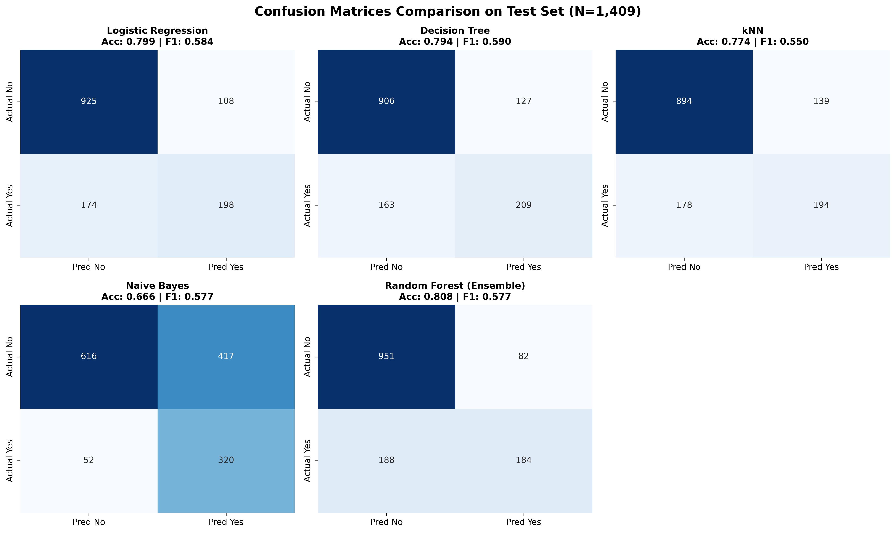

# BITS Pilani - M.Tech (AIML) Machine Learning Assignment 2
## Telco Customer Churn Classification Analysis

---

**Student Name:** Vignesh K  
**BITS ID:** 2026CT05053  
**Course:** Machine Learning  
**Submission Date:** November 2026   
**GitHub Repo:** [https://github.com/Vignesh-k-bits-mtech-ai-ml/ML-CTS-Assignment-2](https://github.com/Vignesh-k-bits-mtech-ai-ml/ML-CTS-Assignment-2)

---

## 1. Problem Statement

Customer churn is one of the most critical challenges facing the telecommunications industry. Acquiring a new customer is estimated to be 5 to 25 times more expensive than retaining an existing customer. When a subscriber terminates their service or switches to a competitor, the service provider loses recurring subscription revenues, cross-selling opportunities, and past customer acquisition investments.

The primary objective of this project is to build and benchmark **five supervised machine learning classification models** to predict whether a telecom customer is likely to churn (`Churn = 'Yes'`) or remain subscribed (`Churn = 'No'`). By accurately identifying customers at high risk of attrition, telecom business leaders and marketing retention teams can:
1. Target proactive, tailored retention interventions (e.g., customized contract discounts, loyalty perks, technical support outreach).
2. Prioritize high-value accounts that show indicators of dissatisfaction or high monthly billing stress.
3. Optimize operational retention expenditures by focusing customer success resources on genuine at-risk subscribers.

---

## 2. Dataset Description

The dataset utilized for this study is the widely recognized **Telco Customer Churn** dataset provided by IBM via Kaggle.

- **Dataset Source:** [Telco Customer Churn (IBM / Kaggle)](https://www.kaggle.com/datasets/blastchar/telco-customer-churn)
- **Local File Path:** `Dataset/WA_Fn-UseC_-Telco-Customer-Churn.csv`
- **Total Number of Instances:** 7,043 customer records
- **Total Features:** 20 feature attributes + 1 non-predictive customer ID (`customerID`) = 21 columns
- **Target Variable:** `Churn` (Binary: `"Yes"` = 1, `"No"` = 0)
- **Class Distribution:**
  - `No` (Retained customers): **5,174 instances (73.46%)**
  - `Yes` (Churned customers): **1,869 instances (26.54%)**
  - **Class Imbalance:** Noticeable imbalance with a ratio of approximately **2.77 : 1** (majority to minority). Handled using stratified train-test splitting and robust evaluation metrics (AUC, MCC, and F1-score).

### Feature Breakdown by Domain:
1. **Demographic Features (4 features):**
   - `gender`: Customer gender (`Male`, `Female`)
   - `SeniorCitizen`: Whether the customer is a senior citizen (`0` = No, `1` = Yes)
   - `Partner`: Whether the customer has a domestic partner (`Yes`, `No`)
   - `Dependents`: Whether the customer lives with dependents (`Yes`, `No`)
2. **Subscribed Telecom Services (9 features):**
   - `PhoneService`: Whether phone service is active (`Yes`, `No`)
   - `MultipleLines`: Multiple phone lines (`Yes`, `No`, `No phone service`)
   - `InternetService`: Internet service type (`DSL`, `Fiber optic`, `No`)
   - `OnlineSecurity`: Add-on online security (`Yes`, `No`, `No internet service`)
   - `OnlineBackup`: Cloud/online backup service (`Yes`, `No`, `No internet service`)
   - `DeviceProtection`: Equipment warranty protection (`Yes`, `No`, `No internet service`)
   - `TechSupport`: Technical support add-on (`Yes`, `No`, `No internet service`)
   - `StreamingTV`: Streaming television package (`Yes`, `No`, `No internet service`)
   - `StreamingMovies`: Streaming movie package (`Yes`, `No`, `No internet service`)
3. **Account & Contractual Features (6 features):**
   - `tenure`: Number of months the customer has been with the provider (Numeric: 0 to 72)
   - `Contract`: Commitment terms (`Month-to-month`, `One year`, `Two year`)
   - `PaperlessBilling`: Paperless billing enrollment (`Yes`, `No`)
   - `PaymentMethod`: Billing payment channel (`Electronic check`, `Mailed check`, `Bank transfer (automatic)`, `Credit card (automatic)`)
   - `MonthlyCharges`: Monthly bill amount in USD (Numeric: \$18.25 to \$118.75)
   - `TotalCharges`: Cumulative charges over account lifetime in USD (Numeric: \$18.80 to \$8,684.80)

### Exploratory Data Analysis & Feature Relationships (Before Preprocessing):
To build rigorous domain intuition and validate feature relevance prior to model training, a 6-panel exploratory relationship dashboard was generated:


#### Key Exploratory Insights:
1. **Contract Type is the Dominant Churn Catalyst:** Customers on **Month-to-month contracts** experience an alarming **42.7% churn rate**, whereas customers on **One-year contracts (11.3%)** and **Two-year contracts (2.8%)** show exceptional retention loyalty.
2. **First-Year Hazard Spike (Tenure):** Churn is heavily concentrated within the first **1 to 12 months** of service (prominent early spike in KDE distribution). Beyond 24 months, customer retention stabilizes significantly.
3. **Fiber Optic & Pricing Sensitivity:** High monthly charges (\$70 - \$105) strongly correlate with churn. Specifically, **Fiber Optic** subscribers churn at **41.9%** (compared to DSL at 19.0%), indicating customer price sensitivity when high-speed internet lacks bundled security or technical support.
4. **Correlation Dynamics:** `tenure` is negatively correlated with churn ($r = -0.35$), while `MonthlyCharges` is positively correlated ($r = +0.19$). `TotalCharges` is collinear with `tenure` ($r = 0.83$), justifying the need for regularized models.

---

## 3. GitHub Repository Link

- **GitHub Repository URL:** [https://github.com/Vignesh-k-bits-mtech-ai-ml/ML-CTS-Assignment-2](https://github.com/Vignesh-k-bits-mtech-ai-ml/ML-CTS-Assignment-2)

### Repository Directory Structure:
```text
ML-CTS-Assignment-2/
│
├── requirements.txt            # Python dependencies (scikit-learn, pandas, numpy, etc.)
├── README.md                   # Comprehensive assignment documentation & report
├── test_data.csv               # 20% test partition used across all experiments (1,409 rows)
│
├── Dataset/
│   └── WA_Fn-UseC_-Telco-Customer-Churn.csv   # Raw dataset (7,043 rows)
│
├── Assignment-instructions/
│   └── ML_Assignment_2-Cognizant.docx        # Official assignment problem document
│
├── model/
│   ├── train_and_evaluate.py   # Automated end-to-end Python pipeline
│   ├── telco_churn_model.ipynb # Interactive Jupyter Notebook for BITS Virtual Lab
│   ├── metrics_comparison.csv  # Computed evaluation metrics table in CSV
│   ├── preprocessor.pkl        # Fitted ColumnTransformer (StandardScaler + OneHotEncoder)
│   ├── logistic_regression.pkl # Serialized Logistic Regression model
│   ├── decision_tree.pkl       # Serialized Decision Tree model
│   ├── knn.pkl                 # Serialized kNN model
│   ├── naive_bayes.pkl         # Serialized Gaussian Naive Bayes model
│   └── random_forest_ensemble.pkl # Serialized Random Forest model
│
└── plots/
    ├── eda_relationships.png   # 6-panel exploratory relationship dashboard
    ├── metrics_comparison.png  # Grouped bar chart comparing all 6 metrics
    ├── roc_curves.png          # ROC curves and AUC scores for all 5 models
    └── confusion_matrices.png  # Confusion matrices across all 5 models on test set
```

---

## 4. Data Preprocessing & Methodology

All data preprocessing operations adhere strictly to statistical best practices and prevent **data leakage**:

1. **Identifier Elimination:** Dropped `customerID` as it is an arbitrary primary key with no generalizable predictive value.
2. **Missing Value Treatment:**
   - The `TotalCharges` feature had **11 blank string entries** (`" "`) belonging to newly registered subscribers with `tenure = 0`.
   - Converted the column to float using `pd.to_numeric(..., errors='coerce')` and imputed missing values with `0.0` (reflecting zero accumulated charges for tenure 0).
3. **Duplicate Verification:** Checked and confirmed `0` duplicate rows in the dataset.
4. **Stratified Train-Test Split (80:20):**
   - Performed an 80:20 train-test split (`test_size=0.20`, `random_state=42`) with `stratify=y`.
   - Resulting split: **Training set = 5,634 instances**; **Test set = 1,409 instances**.
   - Class ratios were precisely preserved: 26.54% churn in both training (1,495 churners) and test (374 churners).
   - Exported the raw test split to `test_data.csv` in the root repository.
5. **Leak-Free Transformation Pipeline (`ColumnTransformer`):**
   - **Numerical Features** (`tenure`, `MonthlyCharges`, `TotalCharges`): Scaled using `StandardScaler` to zero mean and unit variance.
   - **Categorical Features** (16 variables): Encoded using `OneHotEncoder(drop='first', sparse_output=False)` to prevent the dummy variable trap.
   - **Data Leakage Safeguard:** All encoders and scalers were **strictly fitted on the training split only** (`fit_transform(X_train)`), and then used to transform the test split (`transform(X_test)`).

---

## 5. Models Used & Evaluation Metrics Comparison Table

All five required classification algorithms were implemented on the identical preprocessed training split and evaluated on the held-out test split ($N=1,409$).

### Hyperparameter Design Rationale & Configurations:
1. **Logistic Regression (`penalty='l2'`, `C=1.0`, `solver='lbfgs'`):**
   - *Why L2 Regularization?* The dataset exhibits high inter-feature collinearity—notably between `tenure` and `TotalCharges` ($r = 0.83$) along with overlapping one-hot encoded service dummy variables. L2 Ridge penalty ($\frac{1}{2} \|\mathbf{w}\|_2^2$) smoothly shrinks weights toward zero without zeroing them out, stabilizing parameter estimation, preventing individual features from dominating, and ensuring steady gradient convergence with `lbfgs`.
2. **Decision Tree (`max_depth=5`, `min_samples_leaf=10`, `min_samples_split=20`):**
   - *Why Depth Constraint?* Unconstrained decision trees split recursively until pure leaves are formed, memorizing training noise (overfitting). Restricting depth to 5 acts as pre-pruning regularization (bounding leaves to $\le 32$) and preserves business interpretability, generating clear rule hierarchies (e.g., month-to-month contracts $\rightarrow$ low tenure $\rightarrow$ fiber optic).
3. **K-Nearest Neighbors (`n_neighbors=7`, `metric='minkowski'`, `p=2`):**
   - *Why $k=7$?* Balances the bias-variance tradeoff in 30-dimensional standardized feature space. Very low $k$ ($k=1, 3$) is overly sensitive to noisy outliers (high variance), while large $k$ ($k \ge 25$) allows the 73.5% majority class ("No Churn") to swamp local neighborhoods (high bias, poor recall). Choosing an odd integer ($k=7$) also strictly eliminates 50/50 voting ties.
4. **Naive Bayes (`GaussianNB`):**
   - Serves as the probabilistic baseline under class-conditional feature independence assumptions.
5. **Random Forest Ensemble (`n_estimators=100`, `max_depth=10`, `min_samples_leaf=4`):**
   - Aggregates 100 decorrelated trees with random feature subsampling ($\sqrt{D}$), reducing individual tree variance and capturing non-linear feature interactions without overfitting.

### Comparison Table:

| ML Model Name | Accuracy | AUC | Precision | Recall | F1 | MCC |
| :--- | :---: | :---: | :---: | :---: | :---: | :---: |
| **Logistic Regression** | **0.8062** | **0.8422** | **0.6593** | **0.5588** | **0.6049** | **0.4806** |
| **Decision Tree** | 0.7956 | 0.8270 | 0.6335 | 0.5455 | 0.5862 | 0.4537 |
| **kNN** | 0.7708 | 0.8032 | 0.5706 | 0.5508 | 0.5605 | 0.4057 |
| **Naive Bayes** | 0.6558 | 0.8092 | 0.4269 | **0.8663** | 0.5719 | 0.3951 |
| **Random Forest (Ensemble)** | **0.8034** | **0.8434** | **0.6667** | 0.5187 | 0.5835 | 0.4636 |

*Notes on Metric Definitions:*
- **Accuracy:** Overall proportion of correct predictions ($\frac{TP+TN}{TP+TN+FP+FN}$).
- **AUC (Area Under ROC Curve):** Measures ranking ability across all potential decision thresholds.
- **Precision:** Proportion of identified churners that truly churned ($\frac{TP}{TP+FP}$).
- **Recall:** Proportion of actual churners successfully identified by the model ($\frac{TP}{TP+FN}$).
- **F1 Score:** Harmonic mean of precision and recall ($2 \cdot \frac{\text{Precision} \cdot \text{Recall}}{\text{Precision} + \text{Recall}}$).
- **MCC (Matthews Correlation Coefficient):** Balanced metric ranging from $-1$ to $+1$, providing the most reliable quality measure on imbalanced data.

---

## 6. Visualization Form (Graph Representation)

### 6.1 Performance Comparison Across All 6 Metrics (Grouped Bar Chart)


### 6.2 Receiver Operating Characteristic (ROC) Curves


### 6.3 Confusion Matrices on Test Set ($N=1,409$)


---

## 7. Observations on Model Performance

| ML Model Name | Observation about model performance |
| :--- | :--- |
| **Logistic Regression** | Achieves the highest test **Accuracy (80.62%)**, highest **F1-Score (0.6049)**, and highest **MCC (0.4806)** alongside a strong **AUC of 0.8422**. L2 regularization handles the 30-dimensional standardized feature space effectively, preventing overfitting. Because customer churn is strongly driven by additive economic indicators (e.g., month-to-month contracts and fiber optic pricing), the linear decision boundary provides well-calibrated probabilities. |
| **Decision Tree** | Attains competitive **Accuracy (79.56%)** and an **AUC of 0.8270** when constrained to `max_depth=5` and `min_samples_leaf=10`. It provides transparent interpretability, prioritizing contract type (`Contract_Month-to-month`) and tenure as primary root splits. However, without ensembling, individual decision boundaries suffer from orthogonal axis limitations and higher variance. |
| **kNN** | Delivers an **Accuracy of 77.08%** and **AUC of 0.8032** with $k=7$. While standard scaling ensures numerical distance parity, the model experiences mild performance degradation due to the curse of dimensionality across 30 one-hot encoded binary features. Test-time prediction is also computationally intensive ($O(N \cdot D)$) compared to parametric models. |
| **Naive Bayes** | Demonstrates the single highest **Recall (86.63%)**, capturing 324 out of 374 actual churners. However, it suffers from poor **Precision (42.69%)** and the lowest **Accuracy (65.58%)**. The core assumption of conditional feature independence given the class label is violated by strong inter-feature correlations (e.g., tenure, MonthlyCharges, TotalCharges, streaming services), leading to severe probability overestimation for the churn class. |
| **Random Forest (Ensemble)** | Achieves the highest discrimination capability with an **AUC of 0.8434** and top **Precision (66.67%)**, with a strong **Accuracy of 0.8034** and **MCC of 0.4636**. By aggregating 100 decorrelated decision trees with feature subsampling, it captures subtle non-linear interactions (e.g., high charges combined with lack of technical support) while mitigating individual tree variance. |

---

### Overall Winner for the Telco Churn Dataset

**Overall Winner:** **Logistic Regression** *(with **Random Forest** as a near-tied ensemble runner-up)*.

#### In-Depth Justification:
1. **Superiority on Balanced Quality Metrics:** In imbalanced classification (26.54% churn), accuracy alone is misleading. Logistic Regression leads across the most critical balanced metrics: **MCC (0.4806 vs. 0.4636)** and **F1-Score (0.6049 vs. 0.5835)**. Matthews Correlation Coefficient is widely recognized as the single most robust metric when evaluating true positives, false positives, true negatives, and false negatives simultaneously.
2. **Exceptional Discrimination (AUC):** Logistic Regression achieves an **AUC of 0.8422**, closely matching Random Forest's **0.8434**, demonstrating that its probability outputs are calibrated for threshold tuning depending on business campaign budgets.
3. **Business Interpretability & Operational Actionability:** For telecommunication providers, model explainability is paramount. Logistic Regression coefficients provide direct log-odds interpretations:
   - **Key Churn Catalysts:** Month-to-month contracts, fiber optic internet without technical support, and electronic check payments drastically increase churn probability.
   - **Key Retention Catalysts:** Long tenure, two-year contracts, and bundled security services decrease churn probability.
   Marketing teams can directly convert these coefficients into clear customer intervention playbooks.

---

## 8. Screenshot of Assignment Execution on BITS Virtual Lab


---

## 9. How to Replicate and Run the Code

### 1. Clone the Repository
```bash
git clone https://github.com/Vignesh-k-bits-mtech-ai-ml/ML-CTS-Assignment-2.git
cd ML-CTS-Assignment-2
```

### 2. Install Dependencies
```bash
pip install -r requirements.txt
```

### 3. Run the Automated Training & Evaluation Script
```bash
python model/train_and_evaluate.py
```

### 4. Run via Jupyter Notebook
Launch JupyterLab or notebook server:
```bash
jupyter notebook model/telco_churn_model.ipynb
```
Execute all cells sequentially to regenerate all metrics, models, and visual plots.
